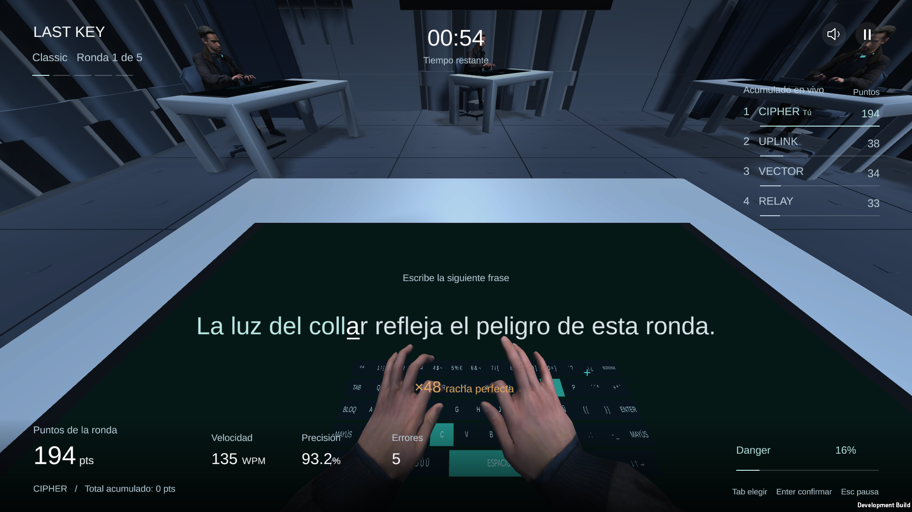

# LAST KEY

Competencia de mecanografía 3D por rondas, desarrollada con Unity 6.

**4 participantes · 5 rondas de 60 s · gana la mayor puntuación acumulada.**
Danger 100% elimina solo de la ronda actual; los puntos se conservan.



## Para empezar

```bash
git clone https://github.com/FernandoR0/last-key-game.git
cd last-key-game
```

1. Instala **Unity 6000.6.0f1** desde Unity Hub y añade esta carpeta como proyecto.
2. Lee [SETUP_COLABORADORES.md](SETUP_COLABORADORES.md): los archivos fuente ActorCore/Mixamo se obtienen por separado desde sus bibliotecas oficiales.
3. Ejecuta `python Tools/check_setup.py` para comprobar las dependencias visuales.
4. Con las dependencias listas, ejecuta `LastKey.Editor.ProductionVisualSetup.Prepare` desde Unity. Abre `Assets/LastKey/Scenes/LastKey.unity` y pulsa Play; también está el menú **LAST KEY → Play Main Game**.

**Importante:** un clon limpio contiene código, escena, configuración y recursos redistribuibles, pero requiere los archivos ActorCore/Mixamo para reproducir el personaje y las animaciones actuales. No se incluyen Library, builds, cuentas, grabaciones personales ni fuentes privadas de esos proveedores.

## Estado jugable

- Una persona y tres bots; cinco rondas con puntuación acumulada.
- WPM, precisión, errores, combo, Danger y clasificación en vivo.
- NULL: directivas competitivas temporales. ECHO: retos opcionales de riesgo/recompensa.
- Classic principal; Code, Numbers, Memory y Sudden Death beta.
- Cámara en primera persona, pantalla horizontal y teclado integrados en la mesa.
- Cuatro identidades que comparten temporalmente un personaje ActorCore.
- Introducción de la primera ronda, collar, animaciones Mixamo y audio por estado.
- Revisión 31: tecleo 2,6–7,8 s del clip original; diez dedos y muñecas conservados.

**Pendiente:** salas multijugador, Chaos, Story Mode, voces personales, personalización y cuatro modelos finales distintos. No hay publicación confirmada en Unity Play. Los enlaces `127.0.0.1` de informes antiguos solo funcionan en el equipo que ejecuta el servidor.

## Dónde trabajar

| Área | Ruta |
|---|---|
| Reglas, rondas y puntuación | `Assets/LastKey/Core/` |
| Menús y HUD | `Assets/LastKey/Runtime/LastKeyGame.UI.cs` |
| Flujo de partida y entrada | `Assets/LastKey/Runtime/LastKeyGame.cs` |
| Personajes y animación | `ImportedMotionPilot.cs`, `MatchCharacterVisual.cs` |
| Arena y cámaras | `ArenaFactory.cs`, `CameraDirector.cs` |
| Música y efectos | `MusicManager.cs`, `GameAudio.cs` |
| Datos ajustables | `Assets/Resources/last_key_rules.json`, `last_key_content.json` |

Las rutas abreviadas están dentro de `Assets/LastKey/Runtime/`.

## Pruebas y builds

Sin Unity ni los assets privados, instala **.NET SDK 10** y ejecuta las pruebas del núcleo:

```bash
dotnet run --project Tests/LastKey.Core.Tests.csproj
```

Con las dependencias visuales preparadas:

```text
Unity.exe -batchmode -quit -projectPath <proyecto> -executeMethod LastKey.Editor.ProductionVisualSetup.BuildWindows
Unity.exe -batchmode -quit -projectPath <proyecto> -executeMethod LastKey.Editor.ProductionVisualSetup.BuildWebGL
```

Instala los módulos Windows Build Support y WebGL Build Support según el destino. `BuildWebGLPreview` compila más rápido para revisión local. Las builds se generan en `Builds/` y no se guardan en Git.

## Colaborar

Lee [CONTRIBUTING.md](CONTRIBUTING.md). Se puede contribuir mediante **fork + pull request**, sin acceso de escritura al repositorio principal. Para trabajo directo en ramas, Fernando debe invitar a cada compañero como colaborador.

[Estado de implementación](IMPLEMENTATION_STATUS.md) · [Recursos y atribuciones](ASSET_MANIFEST.md) · [Corrección de tecleo](TYPING_REVIEW_31.md)

[GDD visual en Figma](https://www.figma.com/board/mxgcSJudH0V6kI5B9JVWjI/?node-id=2031-319)
